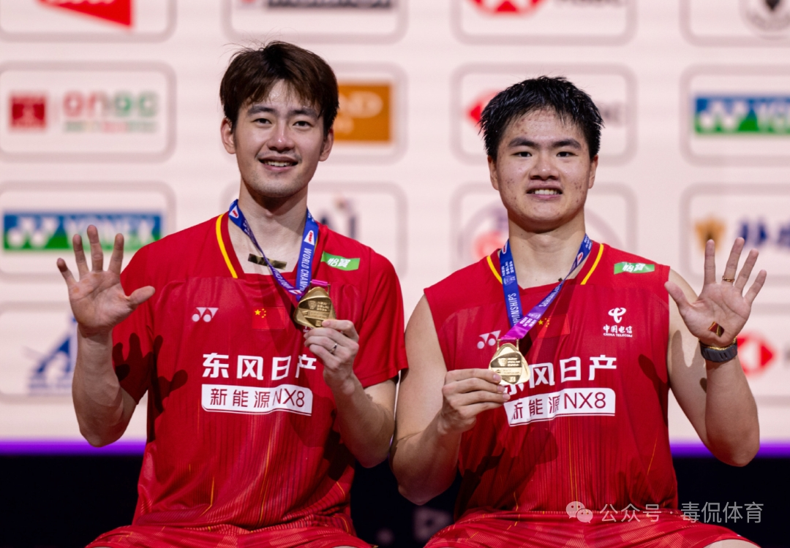
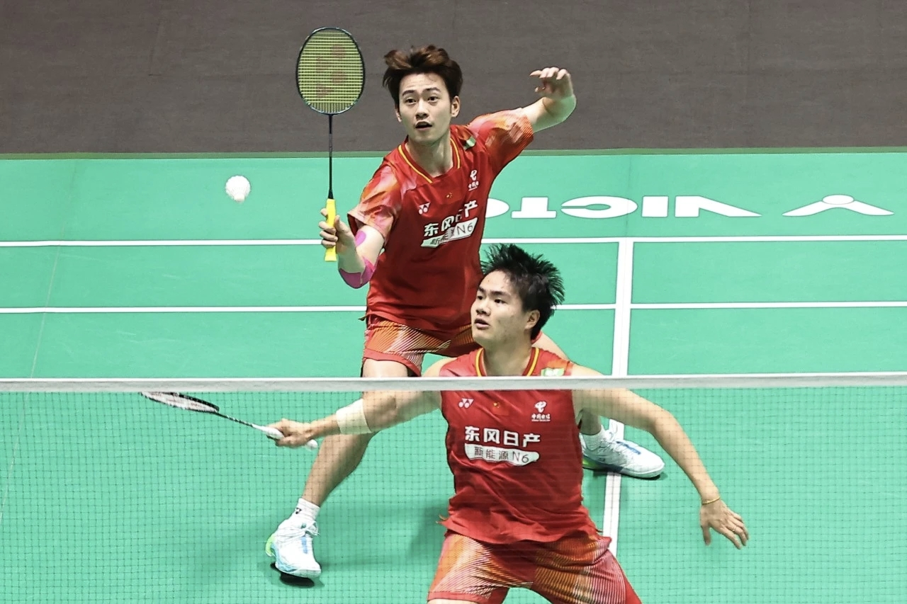
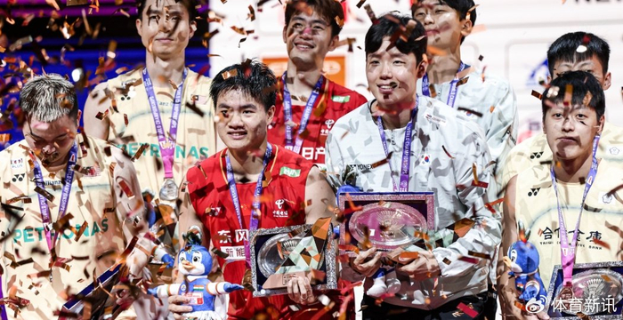

北京时间 8 月 23 日晚，印度新德里，2026 年世界羽毛球锦标赛男双决赛。

3 号种子梁伟铿/王昶对面站着的，是 2022 年世锦赛冠军、马来西亚组合谢定峰/苏伟译——一个不那么好对付的对手。但这一晚，"梁王"组合没给对方太多机会：21-17、21-16，直落两局，干脆利落。

这是他们职业生涯第一座世锦赛冠军奖杯，也是国羽男双时隔八年重回世界之巅——上一次，还要追溯到 2018 年的李俊慧/刘雨辰。

## 比赛是怎么赢下来的

首局开局，梁王组合凭借凌厉的后场重杀和紧凑的网前封挡，很快打出 5-1 的领先。谢定峰/苏伟译毕竟是拿过世锦赛的老搭档，调整轮转节奏后一路追到 5 平，此后双方多次战平，一直纠缠到 13 平。关键分上，梁王组合衔接更快、进攻更连贯，一波连续得分拉开到 18-14，以 21-17 先下一城。

第二局他们打得更加释放：7-2 开局，带着 11-8 进入技术间歇。梁伟铿后场进攻势大力沉，王昶网前封堵滴水不漏，轮转衔接行云流水。马来西亚组合试图变速突击扭转局面，但急躁带来的主动失误越来越多。21-16，胜负已定。

赛后梁伟铿说："决赛前看了队友的比赛，感受到一定压力，在上场前尽可能调整状态，去拼这一场球。"

## 从巴黎的银，到新德里的金

这枚金牌的分量，得放到更大的时间线上看。

巴黎奥运会上，梁王组合一路打进决赛，最终收获银牌。那之后，两人的状态经历过起伏，外界对这对年轻人的质疑也从未停止——火力够猛，但关键分处理不够稳，是大家给他们贴过的标签。

这次新德里世锦赛，他们一路过关斩将：十六强击败丹麦组合阿斯特鲁普/拉斯姆森，半决赛力克中国台北组合李哲辉/杨博轩，决赛零封马来西亚强敌。最明显的变化在于：从过去依靠速度和冲击力赢球，到如今在关键分阶段依然稳定。这对组合完成了从"冲击者"到"掌控者"的蜕变。

而在这条蜕变之路背后，还有一个人不得不提——傅海峰。这位两夺奥运男双金牌的传奇，如今是国羽男双教练组成员，手里带的正是梁伟铿和王昶。当年以"后场重炮"著称的他，最懂这对年轻人缺什么：关键分不手抖的沉稳。八年后把男双世锦赛金牌重新拿回来，某种意义上也是两代"重炮手"的接力。

## 不止一块金牌

本届世锦赛国羽整体收获 1 金 2 银 3 铜：男双的这枚金牌是唯一一金，混双冯彦哲/黄东萍、女双刘圣书/谭宁摘银，蒋振邦/魏雅欣、李怡婧/罗徐敏、王祉怡各收一枚铜牌。

对世界羽坛来说，这也是一个新时代的注脚：法国 21 岁新星拉尼尔爆冷夺得男单冠军，法国组合吉凯尔/德尔吕成为法国历史上首对世锦赛混双冠军——传统强队的优势正在缩小，新力量不断涌现。接下来的名古屋亚运会，才是更近的试金石。

但对此刻的梁王组合来说，先享受这一晚吧。八年之约，一朝兑现；而下一段路，才刚刚开始。

